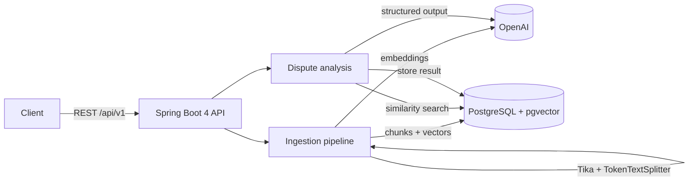
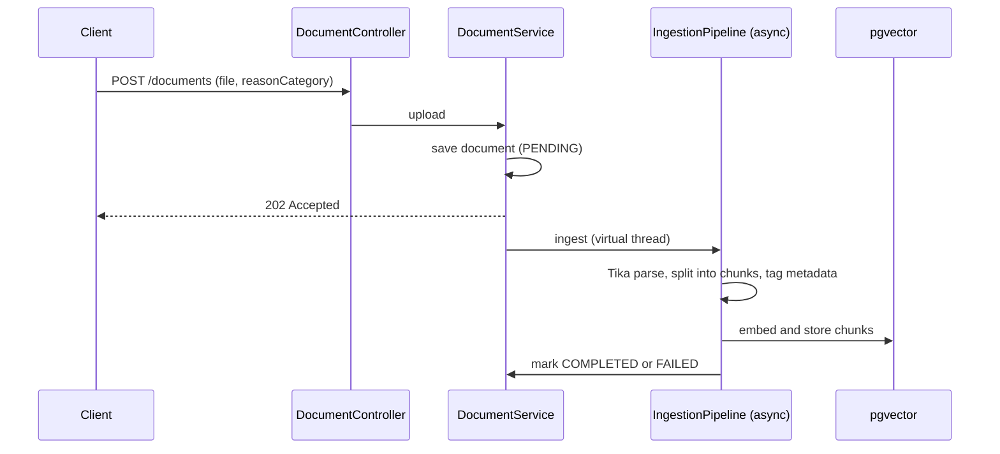
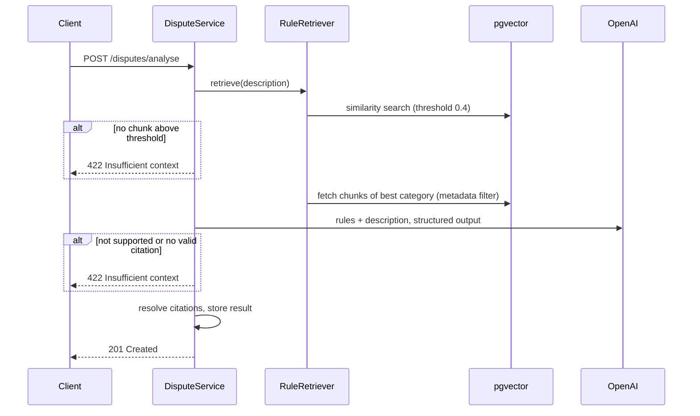

# Chargewise RAG

AI-powered chargeback and dispute resolution copilot built with Spring AI. Given a dispute description, it recommends the dispute category and the evidence the issuer must provide, cites the scheme rules it relied on, and refuses with `422` when the rules don't support an answer.

All card schemes and rules in this project are fictional.

## Features

**Load rules**
- Upload a rules document (PDF, DOCX or TXT) together with its reason category
- Apache Tika extracts the text and `TokenTextSplitter` splits it into chunks
- Each chunk is tagged with `documentId`, `reasonCategory` and `filename`
- Chunks are embedded with OpenAI and stored in PostgreSQL with pgvector (HNSW index, cosine distance)
- Ingestion runs asynchronously on Java virtual threads with status `PENDING`, `COMPLETED` or `FAILED`
- Deleting a document removes its row and all its chunk embeddings in one transaction, so no orphaned vectors stay retrievable
- Five fictional rule files, one per category, are loaded on first start

**Analyse a dispute**
- The dispute description is matched against rule chunks with pgvector similarity search
- Context expansion: once the best-matching category is known, its remaining chunks are fetched with a metadata filter, so the rule's evidence section always reaches the model
- OpenAI returns structured output mapped to a Java record: category, required evidence, explanation and source labels
- Citations are resolved from the chunks that were actually retrieved, so the model cannot invent a document or excerpt
- Refusal guard returns `422` instead of guessing
- Each result is stored and can be fetched by ID

## Architecture



### Load rules flow



### Analyse a dispute flow



## Tech stack

| Layer | Technology |
|---|---|
| Language and build | Java 25, Maven |
| Framework | Spring Boot 4.1 (Web MVC, Validation, Data JPA, Actuator) |
| AI | Spring AI 2.0: OpenAI chat and embeddings, ChatClient, structured output, PgVectorStore |
| Document parsing | Apache Tika, TokenTextSplitter |
| Database | PostgreSQL 17 with pgvector (HNSW index) |
| Migrations | Flyway |
| Testing | JUnit 5, Testcontainers |
| Containers | Docker Compose |

## Getting started

### Prerequisites

- Java 25
- Maven 3.9+
- Docker
- An OpenAI API key

### Run

```bash
cp .env.example .env        # set OPENAI_API_KEY
docker compose up -d
mvn spring-boot:run
```

The application starts on `http://localhost:8080`, applies the Flyway migrations and ingests the seed rules. Check it with:

```bash
curl http://localhost:8080/actuator/health
```

### Configuration

All settings are read from `.env` or environment variables. No secrets are stored in the code.

| Variable | Default | Purpose |
|---|---|---|
| `OPENAI_API_KEY` | none | OpenAI API key (required) |
| `OPENAI_CHAT_MODEL` | `gpt-4.1-mini` | Chat model used for analysis |
| `OPENAI_EMBEDDING_MODEL` | `text-embedding-3-small` | Embedding model (1536 dimensions) |
| `DB_URL` | `jdbc:postgresql://localhost:5432/chargewise` | Database URL |
| `DB_USER` / `DB_PASSWORD` | `chargewise` | Database credentials |
| `SEED_ENABLED` | `true` | Load the fictional rules on first start |

Retrieval and chunking are tuned in `application.yml` under `chargewise.*`: chunk size, top-k, similarity threshold and category context size.

## API

| Method | Endpoint | Purpose |
|---|---|---|
| POST | `/api/v1/documents` | Upload a rules document (multipart), returns `202` |
| GET | `/api/v1/documents` | List documents and ingestion status, paginated |
| DELETE | `/api/v1/documents/{id}` | Delete a document and its vectors, returns `204` |
| POST | `/api/v1/disputes/analyse` | Analyse a dispute, returns `201` |
| GET | `/api/v1/disputes/{id}` | Get a stored analysis result |

Errors are returned as RFC 9457 `ProblemDetail`:

| Status | When |
|---|---|
| `400` | Invalid request or unsupported file type |
| `404` | Document or dispute not found |
| `409` | Deleting a document that is still being ingested |
| `422` | No rules match the dispute closely enough, or the rules don't support an answer |

### Example

Request:

```http
POST /api/v1/disputes/analyse
Content-Type: application/json

{ "description": "Customer paid once at the supermarket but was charged the same amount twice, two minutes apart." }
```

Response `201 Created`:

```json
{
  "id": "38aaa6b6-1b1c-4b16-8549-ccad56cfa1a5",
  "description": "Customer paid once at the supermarket but was charged the same amount twice, two minutes apart.",
  "category": "DUPLICATE_PROCESSING",
  "requiredEvidence": [
    "References of both the original and the duplicate transaction",
    "Cardholder statement confirming that only one purchase was made"
  ],
  "explanation": "The customer was charged twice for the same amount at the same merchant within minutes and confirms only one purchase was made, which meets the eligibility conditions in section P40.2.",
  "citations": [
    {
      "document": "duplicate-processing.txt",
      "excerpt": "- Two or more transactions share the card, merchant and amount. - The transactions were processed within 3 calendar days of each other..."
    }
  ],
  "createdAt": "2026-11-11T23:26:00Z"
}
```

Refusal `422 Unprocessable Content`:

```json
{
  "title": "Insufficient context",
  "status": 422,
  "detail": "No rules match this dispute closely enough to make a recommendation.",
  "instance": "/api/v1/disputes/analyse"
}
```

### Trying it out

- **Postman:** import `postman/chargewise-rag.postman_collection.json`. Document and dispute IDs are captured automatically between requests.
- **IntelliJ HTTP client:** open `requests.http`.

Suggested order: list documents, analyse a few disputes, get a result by ID, then upload and delete a document.

## Design decisions

- **Refusal before generation.** If no chunk passes the similarity threshold, the request returns `422` before any LLM call, so off-topic disputes cost no tokens and the model gets no chance to guess.
- **Grounded citations.** Retrieved chunks are labelled `S1`, `S2` and so on, and the model returns labels only. Citations are built from the stored chunks, so every document name and excerpt in a response is real.
- **Context expansion by metadata.** Small chunks give precise matches but can separate a rule's conditions from its evidence list. A second search filtered on `reasonCategory` brings the whole rule into context.
- **Transactional delete.** Document rows and vector rows are removed in one database transaction, so a failed delete never leaves vectors that can still be retrieved.
- **Asynchronous ingestion on virtual threads.** Uploads return `202` immediately and parsing and embedding run in the background.
- **Schema owned by Flyway.** Hibernate runs with `ddl-auto: validate`, and the pgvector table and HNSW index are created by migrations rather than at runtime.

## Project structure

```
src/main/java/com/dj/chargewise/
├── config/        Spring AI, async and application properties
├── controller/    REST controllers
├── service/
│   ├── ingestion/ upload, text extraction, async ingestion, seed data
│   └── dispute/   retrieval, LLM advisor, analysis
├── repository/    JPA repositories and vector chunk deletion
├── entity/        JPA entities
├── dto/           request and response records
├── model/         enums, retrieved chunk, LLM output record
├── exception/     exception hierarchy and global handler
└── util/          metadata keys
src/main/resources/
├── db/migration/  Flyway migrations
├── prompts/       system and user prompt templates
└── seed/rules/    fictional scheme rules
```

## Build and test

```bash
mvn verify
```

Tests run against a real pgvector container through Testcontainers, so Docker must be running.

## Roadmap

Phase 2 adds production-ready features:

- JWT login (`POST /api/v1/auth/login`) with ADMIN and AGENT roles
- Field-level validation errors and a correlation ID in every error
- Resilience4j retry, circuit breaker and time limiter on OpenAI calls
- Idempotency-Key support on dispute analysis
- Rate limiting with Bucket4j
- Micrometer metrics, Prometheus endpoint and structured JSON logs
- Swagger UI with OpenAPI documentation
- WireMock-based integration tests, so CI needs no API key
- Multi-stage Dockerfile and GitHub Actions CI
